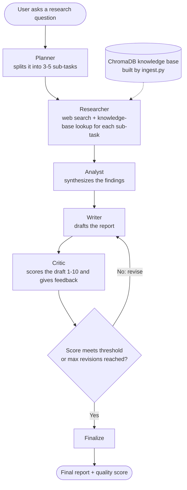

# 🚀 Multi-Agent AI Research Assistant

A LangGraph pipeline where five specialized AI agents plan, research, analyze, write, and critique a report until it meets a quality bar.

## 📌 Overview

Researching a topic well means breaking it down, gathering evidence, synthesizing it, and honestly checking the result. This project automates that loop with five cooperating agents (Planner, Researcher, Analyst, Writer, Critic) orchestrated as a cyclic LangGraph workflow. The Critic scores each draft and sends it back to the Writer for revision until it passes a configurable quality threshold. Reports are grounded in both a local knowledge base (RAG) and live web search.

It is useful for students, analysts, and anyone who wants a structured, self-reviewed first draft on a topic.

## ✨ Features

* Five specialized agents in a cyclic LangGraph graph: Planner → Researcher → Analyst → Writer ⇄ Critic
* Self-critique loop: the Critic scores drafts and triggers automatic revisions until `QUALITY_THRESHOLD` is met or `MAX_REVISIONS` is reached
* RAG with ChromaDB and HuggingFace embeddings, combined with live DuckDuckGo web search
* Interactive Streamlit dashboard that shows agent execution as it happens
* Configurable LLM backend: Groq (cloud) or Ollama (local)
* Command-line modes: interactive REPL, `--demo`, or a single query

## 🔄 Workflow

How a research query becomes a reviewed report. The Critic can send the draft back to the Writer until it passes.



## 🛠️ Tech Stack

* Language: Python
* AI / LLM: Groq or Ollama (configurable)
* Libraries: LangGraph, LangChain, ChromaDB, sentence-transformers (HuggingFace embeddings), DuckDuckGo Search, Streamlit
* Tools: Git, GitHub, Jupyter Notebook

## 📂 Project Structure

```
langgraph-research-assistant/
├── app.py              # Streamlit dashboard
├── main.py             # CLI entry point (REPL / --demo / single query)
├── ingest.py           # Builds the local knowledge base
├── config.py           # Settings loaded from .env
├── graph/
│   ├── state.py        # Shared state schema
│   ├── nodes.py        # The five agents + revision routing
│   └── graph.py        # LangGraph wiring
├── rag/
│   ├── vectorstore.py  # ChromaDB + embeddings
│   └── retriever.py    # Similarity search
├── tools/
│   └── web_search.py   # DuckDuckGo search
├── requirements.txt
└── .env.example
```

## ⚙️ Installation

1. Clone the repository:

```
git clone https://github.com/JAIMINRSOJITRA/langgraph-research-assistant.git
```

2. Navigate to the project:

```
cd langgraph-research-assistant
```

3. Install dependencies:

```
pip install -r requirements.txt
```

4. Create your environment file and add your own key (never commit it):

```
cp .env.example .env
# then set GROQ_API_KEY (or LLM_PROVIDER=ollama for a local model)
```

5. Build the local knowledge base:

```
python ingest.py
```

## ▶️ Usage

Launch the dashboard:

```
streamlit run app.py
```

Or use the command line:

```
python main.py                  # interactive REPL
python main.py --demo           # run a built-in demo query
python main.py "your question"  # single query
```

## 📊 Results / Demo

* The graph compiles and runs end to end; the Planner's list parsing, the Critic's score parsing, and the revision-loop stop conditions (score ≥ threshold, or max revisions reached) were verified with mocked-LLM tests.
* Sidebar settings (quality threshold, max revisions) take effect on every run, not just the first one in a session.
* Run the dashboard locally to see agent steps stream live, then the final report with its quality score.

## 🧠 What I Learned

* Designing cyclic multi-agent workflows with LangGraph, including conditional edges and shared state
* Building safe self-critique loops with two stop conditions (quality threshold and a revision cap) so they always terminate
* Grounding LLM output with both local retrieval (RAG) and live search
* Python module caching pitfalls in Streamlit: a plain `reload` doesn't update names already imported by other modules

## 🔮 Future Improvements

* Add an automated test suite to the repository
* Show source citations next to each claim in the final report
* Persist run history so past reports can be revisited

## 🤝 Contributing

Contributions, issues, and suggestions are welcome.

## 📄 License

This project is licensed under the MIT License.

## 👨‍💻 Author

Jaimin Sojitra

* GitHub: https://github.com/JAIMINRSOJITRA
* LinkedIn: https://www.linkedin.com/in/jaimin-sojitra-4683a1277/
